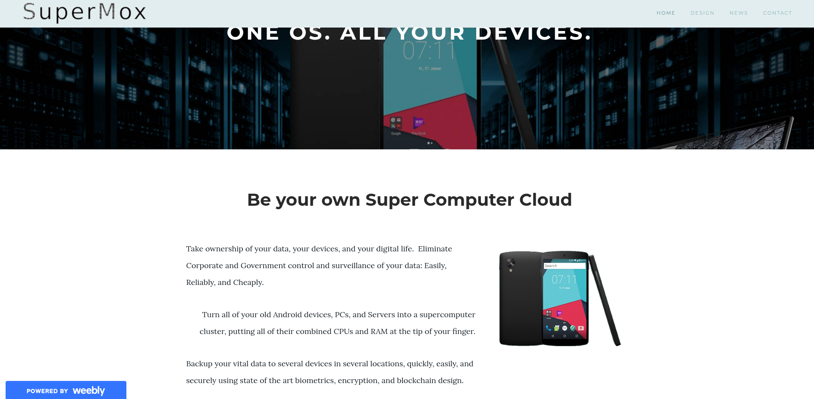
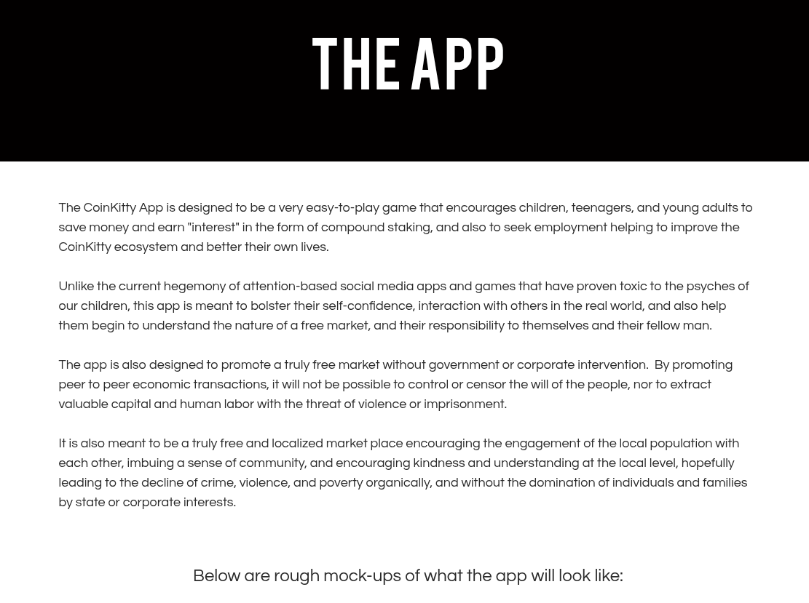

# SuperMox

**The Clustering Mobile Personal Cloud — One OS. All your devices. Be your own supercomputer cloud.**

SuperMox is an open source operating system that joins ALL of your devices — phones, laptops, tablets, desktops, servers, even smart displays — into one supercomputer cluster. All of their CPUs, RAM, and disk space are pooled and shared in real time, so the device you are holding at any moment gets the computing power of the entire cluster. Even an old retired Android phone becomes a multi-core machine with instant response, because it is relying on your more powerful machines.

<p align="center">
  
  
</p>

## The problem

Right now you probably own dozens of CPU cores, dozens of gigabytes of RAM, and terabytes of disk space spread across devices that are off, asleep, or running at a fraction of their capacity. Your devices are not combined. They run different operating systems, share no unified security model, and have different interfaces.

Your data lives in corporate clouds. Corporations use it to make money, force updates on you in the middle of your work, slow down older devices to push upgrades, and charge recurring fees while constantly nudging you into a higher price bracket.

## The idea

In a data center, servers are hooked together into a cluster, and CPUs, RAM, hard drives, and network bandwidth are shared in real time across an array of services and virtual machines. If one service needs extra power, it is allocated automatically. If one physical machine fails, the cluster keeps running.

Imagine we did the same thing for ALL of your devices. SuperMox does that:

- **One cluster.** Phones, PCs, tablets, laptops, servers, and IoT displays become a single machine. The cluster gives the interface you are actively using the most CPU and memory, so the experience stays smooth everywhere.
- **Your own cloud.** Your files — especially the ones that matter, like family photos — are stored across your own machines, replicated across devices and locations (home, work, a car, a relative's house) so nothing is ever lost.
- **Your data, not a corporation's.** No corporate or government surveillance of your data. Access is protected by hardware biometrics and blockchain-based encryption, with 12-word recovery backups.
- **Share with friends and family.** Give people access to your unused resources when you are not using your full infrastructure.
- **Earn from your idle hardware.** Rent out unused compute, memory, and storage to the network in real time and receive cryptocurrency payment in the background while you sleep, hike, or watch a movie — or host anonymous, blockchain-encrypted remote backups for others in exchange for equivalent storage on their hardware.
- **No upgrade anxiety.** The interface looks and acts the same on every device, keeps your settings even on a brand-new device that just joined the cluster, always stays backwards compatible, and never forces you to accept an interface change.

## How it works

SuperMox is built by combining existing open source software into a very easy-to-use interface that is radically simpler than anything that exists today:

- **Backend:** a version of **Devuan** (100% open source, modular Debian) utilizing **ProxMox VE** clustering and virtualization technologies.
- **Frontend:** the **LineageOS** launcher running on a VM, with an app ecosystem available through **F-Droid** — an easy, fast, efficient Android experience almost identical to existing Android OS, without any corporate or government spyware.
- **Cluster monitoring & management:** a lightweight modification of the **Icinga** network services platform for real-time monitoring of cluster resources.
- **Your cloud:** data is stored on a distributed system spread across all devices in the cluster, with a simple, intuitive UI for assigning priority to specific data.
- **Joining is trivial:** installing a new node to the cluster (adding a device) is as easy as scanning a QR code. Installing SuperMox on all of your devices should be a no-brainer, even for grandma or grandpa.
- **Security:** hardware biometrics, blockchain-based encryption, 12-word backups, and traffic that is onion routed locally and over the broader cryptographic network via **TOR**.
- **A free, uncensorable network:** by abstracting data and resources from any single device, SuperMox aims to drive down the cost of IT infrastructure globally, promote a truly free economy, and help build an uncensorable physical network that replaces the current corporate- and government-controlled internet.

## Powered by

| Project | Role |
| --- | --- |
| [Devuan](https://www.devuan.org/) | Modular, open source base OS |
| [ProxMox VE](https://www.proxmox.com/) | Clustering and virtualization |
| [LineageOS](https://www.lineageos.org/) | Open source Android base |
| [F-Droid](https://f-droid.org/) | Open source app market |
| [ownCloud](https://www.owncloud.com/) | Self-managed cloud storage model |
| [TOR](https://www.torproject.org/) | Onion routing for security and anonymity |
| [Purism](https://puri.sm/) | Open hardware and open OS reference |
| [Replicant](https://replicant.us/) | 100% open Android |
| [DecodeOS](https://decodeos.org/) | P2P micro-services cluster |
| [Raspberry Pi](https://www.raspberrypi.com/) | Low-cost cluster building blocks |
| [FSF](https://www.fsfr.org/) | Open source licensing protection |

## Getting started

SuperMox is **in active development** — it is being built piece by piece as an open source project (forking and reworking Proxmox onto a Devuan/Ceres base, with automated monthly builds and virtual machine test pipelines). The full vision, design decisions, and roadmap for the operating system are in the whitepaper:

- **[Whitepaper (PDF)](supermox_white_paper_1.pdf)**
- **[Website: SuperMox.me](https://supermox.me)**

### Roadmap (high level)

1. Open source base: Devuan (Ceres) + ProxMox VE fork with automated build and VM test pipelines.
2. LineageOS-based cluster UI with real-time resource pooling.
3. Distributed, prioritized personal cloud with biometric + blockchain security.
4. QR-code node onboarding for every supported device.
5. Optional sharing with family/friends, and real-time crypto payments for shared resources.

## Documentation

Everything about how SuperMox works and how to build it is in **[docs/](docs/README.md)**:
start with the [architecture overview](docs/architecture.md) and the
[development guide](docs/development.md).

## Status (10.26)

Verified on 2026-10-29:

- Proxmox VE 9.2 (pve-manager 9.2.24, qemu-server 9.2.13, pve-container 6.1.15) built from source on Devuan Ceres.
- Running under sysvinit with no systemd anywhere (checked by `scripts/check-no-systemd.sh` on the running system).
- Web UI on port 8006, survives reboot.
- Node join with a 12-word phrase or QR invite (`supermox-join`, `supermox-joind`) built and unit-tested.
- amd64 first; all architectures planned.

Added since (2026-10-30/31, written by the local model and committed as "pending review"):

- Discovery: signed gossip of node endpoints and a DHT locator so nodes find each other
  across networks.
- Daemon stderr goes to syslog under sysvinit; an offline check keeps upstream overrides honest.
- SuperMox Manager native pages: create VMs and containers, storage, node administration,
  network, disks, permissions and API tokens, backup jobs, pools, HA and firewall, with live
  tests against a running VM. Node shell and guest consoles are in progress.

## Install (PC edition)

1. Boot the SuperMox ISO on bare metal or a VM.
2. Follow the installer (Calamares-based, Spaced Linux desktop).
3. Open `https://<host>:8006` in a browser.

## Build from source

Fetch upstream sources:

```bash
bash scripts/fetch-upstream.sh
```

Build the rootfs and start the build VM:

```bash
bash scripts/build-rootfs.sh
bash scripts/vm-start.sh --background
bash scripts/vm-smoke.sh
```

Set up repos and build packages inside the VM:

```bash
bash scripts/vm-setup-proxmox-repos.sh
bash scripts/vm-build-pkg.sh pve-cluster
bash scripts/vm-build-pkg.sh pve-common
bash scripts/vm-build-pkg.sh pve-manager
bash scripts/vm-build-pkg.sh qemu-server
bash scripts/vm-build-pkg.sh supermox-ve
```

Build the PC-edition ISO (requires a Spaced checkout):

```bash
bash scripts/build-iso.sh
```

## Philosophy

> It's time that we make computers work for you, rather than forcing you to work for your computers. And it's time to take our data back and eliminate even the possibility of Big Brother, whether that be corporate or governmental.
>
> — SuperMox whitepaper

SuperMox will be 100% open source: anyone can submit upgrades from anywhere in the world, be rewarded on the blockchain for their efforts, and help other users — for free or for incentivized rewards — in a radically organic path toward supplanting proprietary ecosystems.

**Take ownership of your data, your devices, and your digital life.**
